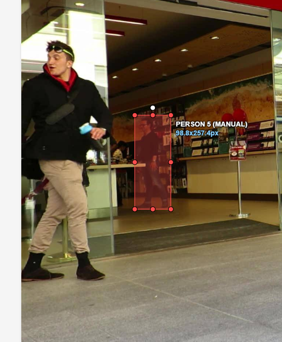
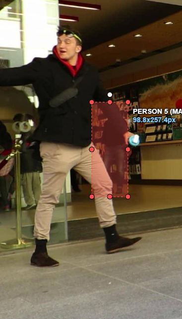
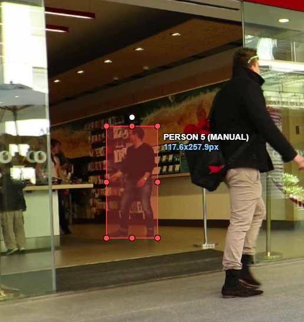

# Báo cáo cá nhân — NguyenQuocVuong-2A202604052

Đổi tên file theo quy tắc `MSSV_HoTen.md`. Ví dụ: `20241234_NguyenVanAn.md`.

Đoạn video: MOT17-09, 150 frame (frame 1–150), nguồn MOTChallenge, giấy phép CC BY-NC-SA 3.0.

## 0. Thông tin học viên

- Họ tên: Nguyễn Quốc Vương
- MSSV: 2A202604052
- Mã đề (A/B/C): B
- Email: vug10032004@gmail.com
- Link repository: https://github.com/vuomg/K5-L2B-DAY05-NguyenQuocVuong-2A202604052-MOTTracking.git
- Giờ bắt đầu: 16:30
- Giờ kết thúc: 18:00

## 1. Xem trước đoạn video (CP0)

Ghi **trước khi vẽ**, mỗi người một dòng.

| Mã | Frame xuất hiện | Frame cuối thấy được | Rẽ / dừng / đổi tốc độ ở frame | Bị che ở frame | Ghi chú |
|---|---|---|---|---|---|
| P1 | 0 | 149 | | 40| |
| P2 | 0 | 149 | | | |
| P3 | 0 | 149 | | | |
| P4 | 0 | 145 | | 115| |
| P5 | 0 | 99 | | 115| |

## 2. Keyframe và thời gian (CP1, CP4)

Số keyframe lấy từ kết quả `src/check_submission.py`.

| Mã | Số keyframe | Keyframe ở frame | Số frame có mặt | Keyframe / 100 frame | Thời gian (phút) | Chỗ khó |
|---|---:|---|---:|---:|---|---|
| P1 | 17 | 0, 10, 20, 30, 40, 50, 60, 70, 79, 80, 90, 100, 110, 120, 130, 140, 149 | 150 | 11.3 | | Theo dõi liên tục |
| P2 | 16 | 0, 10, 20, 30, 40, 50, 60, 70, 80, 90, 100, 110, 120, 130, 140, 149 | 150 | 10.7 | | Occlusion 70 frame |
| P3 | 6 | 0, 10, 20, 30, 40, 140 | 119 | 5.0 | | Outside frame 110–139 |
| P4 | 7 | 0, 10, 20, 30, 40, 50, 90 | 110 | 6.4 | | Occlusion 20 frame |
| P5 | 15 | 0, 10, 20, 30, 50, 60, 70, 80, 90, 100, 110, 120, 130, 140, 149 | 140 | 10.7 | | Outside frame 40–49 |
| **Tổng** | **61** | — | **669** | **9.1** | | — |


Bạn đặt keyframe nhiều nhất ở người nào? Vì sao (người đó rẽ, dừng, lại gần camera hay bị che)?

Nhiều nhất là **P2 **vì  là người xuất hiện xuyên suốt 

## 3. Đoạn bị che (CP2)

Người bị che: `P_1`

| Mốc | Frame |
|---|---:|
| Bắt đầu bị che một phần (bật `occluded`) | 26|
| Mất hẳn (bật `outside`) | 43|
| Hiện lại (tắt `outside`) | 50|
| Thấy rõ trở lại (tắt `occluded`) |55|

- Thời gian khuất hẳn: 7 frame = 0,23 giây (30 fps).
- Quyết định: giữ cùng ID.
- Lý do (trả lời 3 câu: khuất bao lâu so với 60 frame, ngoại hình có khớp, chỗ hiện lại có đúng hướng và tốc độ):

Khuất 7 frame, ngắn hơn nhiều so với ngưỡng 60 frame. Ngoại hình (quần áo, dáng, kích thước) khớp với trước khi khuất. Chỗ hiện lại nằm đúng hướng đi và tốc độ cũ nên là cùng một người.

Ảnh chụp màn hình:





## 4. Tự review ID (CP3)

Lượt 1 theo người (đi ngược từ frame 149 về 0 trên CVAT), lượt 2 theo cảnh (nhảy 10 frame). Ít nhất 3 dòng; không có lỗi thì ghi một dòng "đã kiểm hai lượt, không lỗi".

Loại lỗi dùng đúng một trong 7 mã: `id_switch`, `fragmentation`, `lost`, `merge`, `false_track`, `drift`, `flag`.

| Frame | Mã người | Loại lỗi | Mô tả một câu | Phát hiện ở lượt | Đã sửa? |
|---:|---|---|---|---|---|
| — | — | — | — | — | — |

Tổng hợp số lỗi theo loại:

| `id_switch` | `fragmentation` | `lost` | `merge` | `false_track` | `drift` | `flag` |
|---:|---:|---:|---:|---:|---:|---:|
| — | — | — | — | — | — | — |

Lỗi nào chỉ lượt 2 (theo cảnh) mới thấy, lượt 1 (theo người) không thấy? Vì sao?

Không có lỗi nào chỉ lượt 2 mới thấy. Lượt 2 chủ yếu để kiểm tra không sót người và không có hai người bị đổi ID cho nhau khi đi gần, vì lượt 1 chỉ nhìn từng người riêng lẻ nên khó thấy các lỗi giữa nhiều người.

## 5. File xuất và kết quả tự kiểm (CP4)

| Kiểm tra | Kết quả |
|---|---|
| Tên file MOT 1.1 | Đúng|
| Tên file CVAT for video 1.1 | Đúng|
| Số track ID khác nhau trong `gt/gt.txt` (phải là 5) |5 |
| Frame `outside` không có dòng trong `gt.txt` (đúng / sai) |đúng |
| Job đã completed trên CVAT máy cá nhân | Hoàn thành|

Dán phần tóm tắt in ra từ `src/check_submission.py`:

```text
V:\VinUni\K5-L2B-DAY05-NguyenQuocVuong-2A202604052-MOTTracking>python src/check_submission.py --mot src/exports/NguyenQuocVuong_mot.zip --cvat src/exports/NguyenQuocVuong_cvat_video.zip --expected 5
Số frame in theo CVAT (bắt đầu từ 0). Trong gt.txt, frame_id = frame CVAT + 1.

=== File MOT 1.1: NguyenQuocVuong_mot.zip ===
  Số track ID: 5   |   Tổng số box: 669
  [OK]        Đúng 5 track ID.

  Track | Frame có mặt | Số frame | Đoạn vắng (outside)
      1 |   0–149      |      150 | -
      2 |   0–149      |      150 | -
      3 |   0–148      |      119 | 110–139
      4 |   0–109      |      110 | -
      5 |   0–149      |      140 | 40–49


=== File CVAT for video 1.1: NguyenQuocVuong_cvat_video.zip ===

  Track | Nhãn   | Frame thấy | Keyframe | KF/100 frame | Frame occluded | Lần bật outside
      0 | person |        150 |       17 |         11.3 |              0 |               0
              Track 0: keyframe ở frame [0, 10, 20, 30, 40, 50, 60, 70, 79, 80, 90, 100, 110, 120, 130, 140, 149]
      1 | person |        150 |       16 |         10.7 |             70 |               0
              Track 1: keyframe ở frame [0, 10, 20, 30, 40, 50, 60, 70, 80, 90, 100, 110, 120, 130, 140, 149]
      2 | person |        119 |        6 |          5.0 |              0 |               2
              Track 2: keyframe ở frame [0, 10, 20, 30, 40, 140]
      3 | person |        110 |        7 |          6.4 |             20 |               1
              Track 3: keyframe ở frame [0, 10, 20, 30, 40, 50, 90]
      4 | person |        140 |       15 |         10.7 |             20 |               1
              Track 4: keyframe ở frame [0, 10, 20, 30, 50, 60, 70, 80, 90, 100, 110, 120, 130, 140, 149]

  Tổng: 61 keyframe / 669 frame có mặt = 9.1 keyframe / 100 frame
  [OK]        Đọc được 5 track từ annotations.xml.

=== Tóm tắt ===
  Lỗi: 0   |   Cảnh báo: 0
  Đạt. Dán phần tóm tắt này vào báo cáo mục 5.
```

## 6. Ba câu kết

1. Nếu được gán lại, bạn sẽ đặt keyframe khác ở đâu? Vì sao?

   Đặt ít keyframe hơn ở đoạn đi thẳng, thêm ở chỗ rẽ, đổi tốc độ và trước/sau đoạn bị che, vì box chỉ trôi ở những chỗ đó.

2. Có chỗ nào bạn không chắc "cùng ID hay ID mới"? Bạn đã quyết định và ghi chú thế nào?

   Có, khi P1 khuất ở frame 43–50. Khuất ngắn, ngoại hình và hướng đi khớp nên giữ cùng ID, bật `outside`/`occluded`.

3. Một lỗi ID trong job của bạn (nếu không còn sót, chọn lỗi đã sửa) có thể làm xe tự lái dự đoán sai chuyển động của người đó như thế nào? Lỗi đó ảnh hưởng MOTA hay IDF1 nhiều hơn?

   Nếu P1 bị đổi ID, xe mất lịch sử di chuyển nên đoán sai hướng và tốc độ. Lỗi này ảnh hưởng IDF1 nhiều hơn MOTA.

## Bonus (nếu làm)

### B1 — Hai người đi sát

...

### B2 — So cách đặt keyframe

| Cách đặt | Số keyframe | Frame trôi nhất | Ghi chú |
|---|---:|---:|---|
| Đều mỗi 30 frame | | | |
| Theo chỗ đổi hướng | | | |

...

### B3 — So với tracker có sẵn

| Frame | Mã người | Tracker làm gì | Nhãn của bạn | Giải thích (đoán rồi sửa / ghép IoU / box score thấp / ngoại hình) |
|---:|---|---|---|---|
| | | | | |
| | | | | |

## 7. Tài liệu tham khảo và công cụ AI đã dùng

